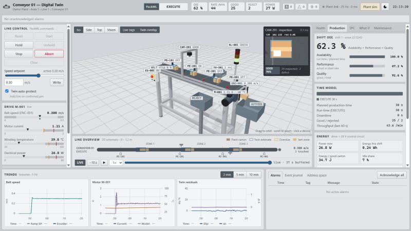
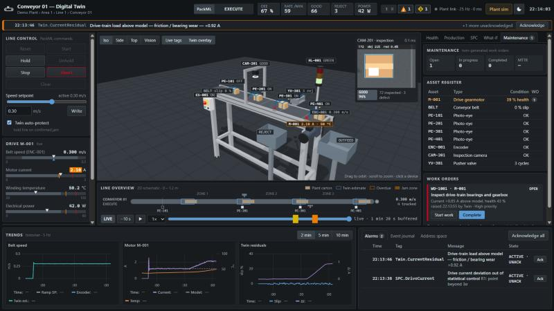
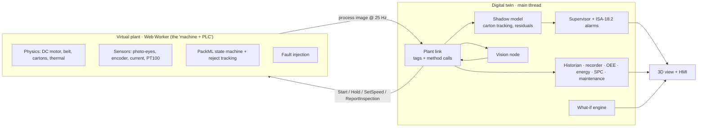

# Conveyor 01 — Digital Twin

**A web-based digital twin of an inspection-and-reject mini conveyor, built for the Industrial IoT Engineering mini project.**

A physics-based virtual plant (motor, belt, cartons, photo-eyes, encoder, camera, reject pusher, PackML controller) runs
on its own thread. The twin connects to it **only through tags and method calls**, the way it would talk to a real PLC.
It mirrors the machine in 3D, runs its own model to detect faults the sensors alone can't show, predicts motor
temperature, raises maintenance work orders, and lets you test setpoint changes before applying them.





---

## Contents

- [Quick start](#quick-start)
- [What the twin does](#what-the-twin-does)
- [Architecture](#architecture)
- [How cartons are accepted or rejected](#how-cartons-are-accepted-or-rejected)
- [Demo script](#demo-script-7-min)
- [Project structure](#project-structure)
- [Engineering models](#engineering-models)
- [Standards followed](#standards-followed)
- [Limitations and future scope](#limitations-and-future-scope)

---

## Quick start

**Run the finished build (no install, works offline).** Open `dist/index.html` in Chrome or Edge. It is a single
self-contained file, with the plant simulation worker inlined.

**Run from source.** Requires Node.js 18 or newer.

```bash
npm install
```

```bash
npm run dev
```

The dev server opens at http://localhost:5173. To regenerate `dist/index.html`:

```bash
npm run build
```

Then in the app: **Reset → Start**. Use **Plant sim** (top right) to inject faults.

---

## What the twin does

| Area | Capability |
|---|---|
| **Live mirror** | 25 Hz process image to a to-scale Three.js model, live value tags on every device, 2D line overview |
| **Control** | PackML commands (Reset / Start / Hold / Unhold / Stop / Abort / Clear) and speed setpoint, with interlocks |
| **Twin model** | Tracks every carton from encoder counts and photo-eye edges (predict → correct); blue wireframes show where the twin *thinks* each carton is |
| **Fault diagnosis** | Belt slip (transit time vs encoder), jam vs sensor failure, drive-train friction (measured vs modelled current) |
| **Auto-protect** | Confirmed jam → twin commands **Hold** on the plant |
| **Predictive** | Drive-train health index, thermal forecast (time to alarm / trip), max sustainable speed advisory |
| **Quality** | Camera inspection on rendered frames, verdict sent to the PLC, pusher rejects defects |
| **What-if** | Runs a private copy of the plant ≈ 10 000× faster than real time to compare setpoints (throughput, OEE, energy, temperature) |
| **Time-travel replay** | Last 10 min recorded; click an alarm marker to replay that moment in 3D |
| **Production** | OEE (availability × performance × quality), state time model, CSV shift report |
| **Energy** | Drive + control power, Wh per shift, J per good carton, idle share, CO₂e |
| **SPC** | I-chart on motor-current deviation, p-chart on reject rate, Western Electric rules |
| **Maintenance** | Work orders raised automatically from twin evidence; completing one repairs the virtual plant; MTTR |
| **Alarms** | ISA-18.2 lifecycle (unack / ack / return-to-normal), priority shapes, alarm banner, event journal |
| **HMI** | ISA-101 high-performance style, light and dark themes, floating device faceplates, OPC UA-style address space browser |

---

## Architecture



The key design rule: **the twin never reads simulator internals.** `src/bus/link.ts` is the only seam between twin and
plant. Replacing the worker with an OPC UA or MQTT client that exposes the same tags needs no change anywhere else.
That's the virtual-commissioning argument.

---

## How cartons are accepted or rejected

1. **Trigger.** When a carton's leading edge breaks photo-eye **PE-201**, the PLC gives it a tracking ID and requests an inspection.
2. **Image.** The twin renders the CAM-201 camera view of the real scene (160 × 120 px) at that instant.
3. **Segmentation.** Each pixel is converted to HSV. Saturated, reasonably bright pixels are *carton*; the dark grey belt and frame are ignored.
4. **Defect measure.** Inside the carton, pixels with red hue (< 14° or > 340°, saturation > 0.55) are counted as a wrong (red) label.
5. **Decision for that camera image:**
   - **NO_READ:** the image is dark (camera fault) or the carton covers less than 4 % of it;
   - **DEFECT:** red pixels exceed 6 % of the carton area;
   - **GOOD:** otherwise.
6. **Action in the PLC.** The verdict is stored against the tracking ID in a FIFO queue. When the carton reaches **PE-301**, the PLC reads the head of the queue:
   - **GOOD** → passes to outfeed;
   - **DEFECT**, **NO_READ**, or no verdict in time → pusher **YV-301** fires after a short encoder-measured delay, so it hits the carton centre. This is **fail-safe**: anything not positively confirmed good is rejected.
7. **Tracking window.** If a carton's tracking entry exceeds 0.45 m of encoder travel (e.g. during a jam), it is dropped and logged.

---

## Demo script (≈ 7 min)

Start the line about **1 minute before presenting** so the SPC charts can learn a healthy baseline.

1. **Start-up.** Reset → Start (STOPPED → RESETTING → IDLE → STARTING with horn → EXECUTE). Point out the live tags, the 2D overview and the blue twin estimates.
2. **Vision and reject.** Red-label cartons are classified DEFECT and pushed into the reject bin.
3. **Belt slip.** Plant sim → slip 25 %. The encoder still reads 0.300 m/s, yet the twin estimates ≈ 25 % slip from transit times.
4. **Jam.** Obstruct zone 2: the zone pulses orange, a P1 alarm appears and auto-protect issues **Hold**. Remove obstruction → Acknowledge → Unhold.
5. **Time travel.** Click the red marker on the replay timeline to watch the jam again.
6. **Sensor fault.** PE-301 stuck off: diagnosed as a *sensor* fault (not a jam), so the line keeps running.
7. **Predictive maintenance.** Bearing wear 100 %: current above model, health ≈ 40 %, SPC out of control, speed advisory, work order raised.
8. **What-if.** 0.42 m/s for 60 min: predicted over-temperature trip, while 0.30 m/s survives.
9. **Repair.** Maintenance → Start work → Complete: the repair is applied and health recovers.
10. **Close.** OEE, energy, shift report export, dark theme.

---

## Project structure

```
├── index.html               HMI layout
├── src/
│   ├── main.ts              entry point
│   ├── plant/               virtual plant — the "machine and PLC"
│   │   ├── params.ts        geometry, motor, thermal and drive parameters
│   │   ├── model.ts         physics, sensors, PackML control, faults
│   │   └── plant.worker.ts  20 ms scan, publishes the process image at 25 Hz
│   ├── bus/                 plant link (the only twin ↔ plant seam)
│   │   ├── link.ts          subscription + method calls with status codes
│   │   ├── protocol.ts      message types
│   │   └── tags.ts          OPC UA-style address space (ISA-95 path)
│   ├── twin/                twin services
│   │   ├── shadow.ts        carton tracking, slip, current model, thermal forecast
│   │   ├── supervisor.ts    alarm logic, jam vs sensor-fault diagnosis, auto-protect
│   │   ├── alarms.ts        ISA-18.2 alarm manager + event journal
│   │   ├── vision.ts        inspection image pipeline
│   │   ├── whatif.ts        faster-than-real-time scenario runner
│   │   ├── recorder.ts      time-travel buffer
│   │   ├── oee.ts  energy.ts  spc.ts  maintenance.ts  historian.ts
│   ├── scene/scene.ts       Three.js model of the conveyor
│   └── ui/                  HMI: controller, overview, faceplates, trends, theme, widgets
├── docs/
│   ├── DESIGN.md            system design document
│   ├── SLIDES_OUTLINE.md    presentation outline
│   └── images/              screenshots
└── dist/index.html          single-file offline build
```

---

## Engineering models

| Model | Equation / method |
|---|---|
| Armature circuit | `L·di/dt = V − R·i − Ke·ω`, solved exactly per 5 ms sub-step |
| Rotor | `J·dω/dt = Kt·i − b·ω − Tc − T_load`, with static friction |
| Belt load | Slider-bed drag + per-carton carry friction; stopped cartons slide (higher drag) |
| Winding temperature | `C·dT/dt = i²R − (T − T_amb)/R_th` (time constant shortened to 90 s for demos) |
| Speed control | Feed-forward + PI on encoder speed, 0.5 m/s² ramp |
| Slip estimate | Encoder travel vs known photo-eye spacing per carton transit, EWMA |
| Health index | Measured − modelled steady-state current → % of +1.5 A degradation limit |
| Thermal forecast | `T(t) = T_ss + (T₀ − T_ss)·e^(−t/τ)`, time to 80 °C alarm and 90 °C trip |
| OEE | Availability × Performance × Quality, ideal cycle 0.75 s |
| SPC | I-chart σ = MR̄/1.128; p-chart σ = √(p̄(1−p̄)/n); Western Electric rules |

Full design: [docs/DESIGN.md](docs/DESIGN.md).

---

## Standards followed

- **ISA-95.** Equipment hierarchy in tag paths: `DemoPlant.Area1.Line1.Conveyor01.*`
- **ISA-88 / PackML (ISA-TR88.00.02).** Machine state model and commands
- **ISA-18.2.** Alarm lifecycle, priorities, acknowledge and return-to-normal states
- **ISA-101.** High-performance HMI: grey for normal, colour only for abnormal, shape-coded alarm priorities
- **ISA-5.1.** Instrument tag naming (M-001, PE-101, TT-001, YV-301 …)
- **OPC UA style.** Node IDs, method calls with status codes (`Good`, `BadInvalidState`, …)

---

## Limitations and future scope

**Limitations (be ready for these in Q&A):**
- The plant is simulated, so there is no physical conveyor.
- The plant link has the OPC UA *shape* but is an in-browser message channel, not an OPC UA stack.
- The motor's thermal time constant is accelerated so effects show up within a demo.
- Completing a work order clears the injected fault, standing in for a technician's repair.

**Future scope:**
- Real OPC UA / MQTT (Unified Namespace) connectivity.
- Jetson Nano edge node with a real camera.
- Learned anomaly detection.
- Remaining-useful-life prognostics.
- Multi-line plant model.

---

## License

[MIT](LICENSE) © 2026 Sarthak Wage

*Industrial IoT Engineering — mini project.*
