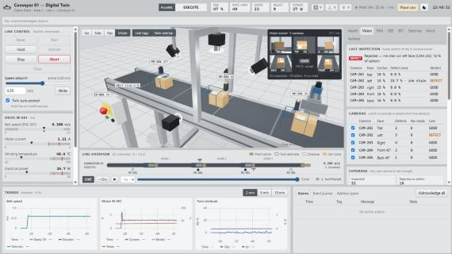
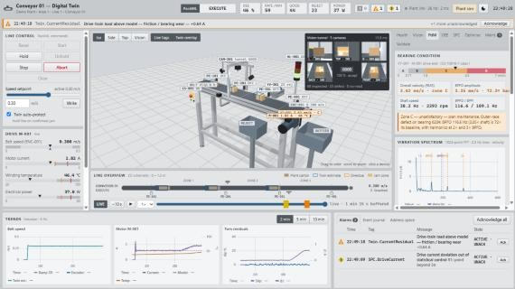
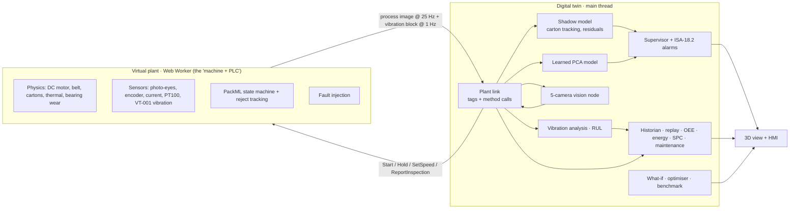

# Conveyor 01 — Digital Twin

**A web-based digital twin of an inspection-and-reject mini conveyor, built for the Industrial IoT Engineering mini project.**

A physics-based virtual plant (motor, belt, cartons, photo-eyes, encoder, vibration sensor, five-camera vision tunnel,
reject pusher, PackML controller) runs on its own thread. The twin connects to it **only through tags and method
calls**, the way it would talk to a real PLC. It then:
- mirrors the machine in 3D;
- runs its own physics model and a learned (PCA) model to detect and diagnose faults;
- predicts bearing failure from vibration;
- raises maintenance work orders;
- optimises the speed setpoint;
- measures its own accuracy with a built-in validation benchmark.


| Five-camera vision tunnel | Predictive maintenance (vibration) |
|---|---|
|  |  |


---

## Contents

- [Quick start](#quick-start)
- [What the twin does](#what-the-twin-does)
- [Architecture](#architecture)
- [How cartons are accepted or rejected](#how-cartons-are-accepted-or-rejected)
- [Predictive maintenance](#predictive-maintenance)
- [Validation results](#validation-results)
- [Demo script](#demo-script-8-min)
- [Project structure](#project-structure)
- [Engineering models](#engineering-models)
- [Standards followed](#standards-followed)
- [Limitations and future scope](#limitations-and-future-scope)

---

## Quick start

**Run the finished build (no install, works offline).** Open `dist/index.html` in Chrome or Edge. It is a single
self-contained file (≈ 217 KB gzipped) with the plant simulation worker inlined.

**Run from source.** Requires Node.js 18 or newer.

```bash
npm install
```

```bash
npm run dev
```

The dev server opens at http://localhost:5173. To typecheck and regenerate `dist/index.html`:

```bash
npm run build
```

Then in the app: **Reset → Start**. Use **Plant sim** (top right) to inject faults.

---

## What the twin does

| Area | Capability |
|---|---|
| **Live mirror** | 25 Hz process image to a to-scale Three.js model, live value tags on every device, 2D line overview |
| **Control** | PackML commands (Reset / Start / Hold / Unhold / Stop / Abort / Clear) and speed setpoint, with interlocks |
| **Twin model** | Tracks every carton from encoder counts and photo-eye edges (predict → correct); blue wireframes show where the twin *thinks* each carton is |
| **Rule-based diagnosis** | Belt slip (transit time vs encoder), jam vs sensor failure, drive-train friction (measured vs modelled current); a confirmed jam → auto **Hold** |
| **Learned anomaly model** | PCA on 10 raw signals with Hotelling T² and Q statistics, learned per operating speed; catches faults no rule was written for and names the signal responsible |
| **Vision tunnel** | 5 cameras (top, left, right, front 45°, back 45°) render the real scene; HSV pipeline per view, fused verdict, fail-safe reject |
| **Predictive maintenance** | VT-001 vibration waveform → FFT spectrum, bearing defect frequencies (BPFO/BPFI), ISO 10816 zones, P-F curve, RUL, strategy cost comparison |
| **Thermal forecast** | First-order winding model → time to alarm / trip, max sustainable speed advisory |
| **What-if & optimiser** | Private copy of the plant run ≈ 10 000× faster than real time; compare setpoints or sweep for the best safe speed |
| **Validation benchmark** | Hundreds of randomised fault scenarios → detection time, diagnosis confusion matrix, false-alarm rate |
| **Time-travel replay** | Last 10 min recorded; click an alarm marker to replay that moment in 3D |
| **Production** | OEE (A × P × Q), state time model, energy per carton, CO₂e, CSV shift report |
| **SPC** | I-chart on motor-current deviation, p-chart on reject rate, Western Electric rules |
| **Maintenance** | Work orders raised automatically (predictive RUL, health, slip, sensors, cameras, unexplained anomalies); completing one repairs the virtual plant; MTTR |
| **Alarms & HMI** | ISA-18.2 lifecycle, priority shapes, alarm banner, event journal, ISA-101 light / dark themes, floating faceplates, OPC UA-style address space |

---

## Architecture



The key design rule: **the twin never reads simulator internals.** `src/bus/link.ts` is the only seam between twin and
plant. Replacing the worker with an OPC UA or MQTT client that exposes the same tags needs no change anywhere else.
That's the virtual-commissioning argument.

---

## How cartons are accepted or rejected

1. **Trigger.** A carton's leading edge breaks photo-eye **PE-201** → the PLC assigns a tracking ID and all five tunnel
   cameras capture at once:
   - **CAM-201:** top;
   - **CAM-202:** left;
   - **CAM-203:** right;
   - **CAM-204:** front at 45°;
   - **CAM-205:** back at 45°.
2. **Find the carton.** Each image is converted to HSV. Pixels with cardboard colour (hue 15–50°, saturation > 0.28) are the carton; belt, frame and background are ignored.
3. **Look for defects inside the carton outline:**
   - red pixels (hue < 14° or > 340°) mean a **wrong label**;
   - blue pixels (hue 190–265°) mean **ink contamination**.
4. **Verdict per camera:**
   - **DEFECT:** defect pixels exceed 5 % of the carton area;
   - **NO_READ:** the image is dark (camera fault) or the carton covers < 3 % of it;
   - **GOOD:** otherwise.
5. **Fusion across cameras:**
   - any camera says DEFECT → **reject**;
   - any camera says NO_READ → **reject (fail-safe)**;
   - all say GOOD → **accept**.
6. **Action.** The verdict is stored against the tracking ID. At **PE-301** the PLC fires pusher **YV-301** for anything that is not GOOD, including cartons whose verdict did not arrive in time.

Defects appear on a random face, so a single top camera would miss most of them. In testing, **0 defects escaped and 0
good cartons were rejected** with all five cameras, while a top camera alone would have passed about 4 in 5 defective
cartons. The Vision tab shows this live, and cameras can be excluded to demonstrate it. The bottom face would need a
camera under a gap between two belts (future scope).

---

## Predictive maintenance

- **Sensor.** VT-001, an accelerometer on the motor drive-end bearing (6204-type, 8 balls), delivers a
  1024-sample block at 2.56 kHz every second.
- **Spectrum.** Hann window + FFT → velocity spectrum (2.5 Hz lines), with markers at the shaft speed (1×), BPFO, 2×/3× BPFO
  and BPFI. Outer-race wear shows up as BPFO (≈ 3.05× shaft speed) and its harmonics rising far above their healthy baseline.
- **Severity.** Overall RMS velocity, 10–1000 Hz, is classified on ISO 10816-1 class I zones:
  - **A** ≤ 0.71 mm/s;
  - **B** ≤ 1.8;
  - **C** ≤ 4.5;
  - **D** > 4.5.
- **P-F curve.** P = entering zone C (potential failure detected); F = zone D (functional failure). A linear trend over
  the last minute gives the **remaining useful life** with a ±2σ band. A predictive work order is raised when RUL < 150 s
  (demo-accelerated time).
- **Economics.** Annual cost per bearing position, assuming Weibull β = 2 wear-out:
  - run-to-failure ≈ ₹ 1.5 lakh;
  - time-based replacement ≈ ₹ 1.0 lakh;
  - predictive ≈ ₹ 0.36 lakh.

  The inputs are editable, and the detection rate is taken from the validation benchmark.

---

## Validation results

From the built-in benchmark: 20 randomised runs per fault, plus 40 minutes of healthy running.

| Injected fault | Rules: detected | Rules: mean time | Correct diagnosis | Learned model: detected | Learned: mean time |
|---|---|---|---|---|---|
| Belt slip 15–35 % | 20/20 | 2.5 s | 100 % | 20/20 | 8.3 s |
| Jam in zone 2 | 20/20 | 2.4 s | 100 % | 0/20 (line already held by rules) | — |
| Photo-eye failure | 20/20 | 1.4 s | 100 % | 20/20 | 11.2 s |
| Bearing wear 50–100 % | 20/20 | 11.5 s | 100 % | 20/20 | 8.4 s |
| Guide rub (no rule exists) | 0/20 | — | — | **20/20** | 8.3 s |

**False alarms in 40 min of healthy running:** 0 from the rules, 0 from the learned model.

The two approaches complement each other:
- **Rules** are faster and name the fault.
- **The learned model** catches the fault nobody wrote a rule for.

---

## Demo script (≈ 8 min)

Start the line about **1 minute before presenting** so the SPC charts and the learned model have a healthy baseline.

1. **Start-up.** Reset → Start (STOPPED → RESETTING → IDLE → STARTING with horn → EXECUTE). Point out the live tags, 2D overview and blue twin estimates.
2. **Vision tunnel.** View → *Vision*. Five camera thumbnails; defects on any face are rejected. Vision tab → untick the side cameras to show defects escaping.
3. **Belt slip.** Plant sim → slip 25 %: the encoder still reads 0.300 m/s, yet the twin estimates ≈ 25 % slip.
4. **Jam + replay.** Obstruct zone 2 → P1 alarm, auto-Hold. Click the red marker on the replay timeline to watch it again.
5. **Unknown fault.** *Misalign zone-3 guide*: no rule fires, but the learned model flags an anomaly and names *Zone 3 transit ratio*.
6. **Predictive maintenance.** Wear progression 40 %/min → PdM tab: BPFO peaks grow, zone A → C (P), RUL counts down, and a predictive work order appears before failure.
7. **Optimise.** Optimise tab → *Find optimal speed* → apply the recommended setpoint.
8. **Validate.** Validate tab → *Run benchmark* → detection times, confusion matrix, false alarms.
9. **Repair & close.** Maintenance → Complete the work order → health recovers. Strategy economics, OEE, shift report.

---

## Project structure

```
├── index.html               HMI layout
├── src/
│   ├── main.ts              entry point
│   ├── plant/               virtual plant — the "machine and PLC"
│   │   ├── params.ts        geometry, motor, thermal, bearing, camera parameters
│   │   ├── model.ts         physics, sensors, vibration, PackML control, faults
│   │   └── plant.worker.ts  20 ms scan, process image @ 25 Hz, vibration @ 1 Hz
│   ├── bus/                 plant link (the only twin ↔ plant seam)
│   │   ├── link.ts  protocol.ts  tags.ts
│   ├── twin/                twin services
│   │   ├── shadow.ts        carton tracking, slip, current model, thermal forecast
│   │   ├── supervisor.ts    rule-based diagnosis, auto-protect
│   │   ├── features.ts      feature extraction for the learned model
│   │   ├── anomaly.ts       PCA, Hotelling T², Q, contributions
│   │   ├── vision.ts        per-view classification and fusion
│   │   ├── vibration.ts     FFT, ISO 10816, bearing frequencies, diagnosis
│   │   ├── rul.ts           remaining useful life
│   │   ├── economics.ts     maintenance strategy cost model
│   │   ├── whatif.ts  optimiser.ts  benchmark.ts
│   │   ├── alarms.ts  recorder.ts  historian.ts  oee.ts  energy.ts  spc.ts  maintenance.ts
│   ├── scene/scene.ts       Three.js model of the conveyor and vision tunnel
│   └── ui/                  HMI controller and views
├── docs/                    DESIGN.md, SLIDES_OUTLINE.md, images/
└── dist/index.html          single-file offline build
```

---

## Engineering models

| Model | Equation / method |
|---|---|
| Armature circuit | `L·di/dt = V − R·i − Ke·ω`, solved exactly per 5 ms sub-step |
| Rotor | `J·dω/dt = Kt·i − b·ω − Tc − T_load`, with static friction |
| Winding temperature | `C·dT/dt = i²R − (T − T_amb)/R_th` (time constant shortened to 90 s for demos) |
| Speed control | Feed-forward + PI on encoder speed, 0.5 m/s² ramp |
| Slip estimate | Encoder travel vs known photo-eye spacing per carton transit, EWMA |
| Health index | Measured − modelled steady-state current → % of +1.5 A degradation limit |
| Learned model | PCA (90 % variance), T² limit from χ² (Wilson–Hilferty, 99.9 %), Q limit empirical; 4 consecutive exceedances |
| Bearing frequencies | `BPFO = n/2·fr·(1 − d/D)`, `BPFI = n/2·fr·(1 + d/D)` (n = 8, d = 7.94 mm, D = 33.5 mm) |
| Vibration severity | Velocity RMS 10–1000 Hz from the windowed FFT, ISO 10816-1 class I zones |
| RUL | Linear regression over 60 s, extrapolated to 4.5 mm/s, ±2σ slope band |
| Strategy cost | Weibull β = 2 life; age replacement at 50 % of mean life; predictive at P with benchmark detection rate |
| OEE / SPC | A × P × Q, ideal cycle 0.75 s; I-chart σ = MR̄/1.128; p-chart σ = √(p̄(1−p̄)/n) |

Full design: [docs/DESIGN.md](docs/DESIGN.md).

---

## Standards followed

- **ISA-95.** Equipment hierarchy in tag paths: `DemoPlant.Area1.Line1.Conveyor01.*`
- **ISA-88 / PackML (ISA-TR88.00.02).** Machine state model and commands
- **ISA-18.2.** Alarm lifecycle, priorities, acknowledge and return-to-normal states
- **ISA-101.** High-performance HMI: grey for normal, colour only for abnormal, shape-coded alarm priorities
- **ISA-5.1.** Instrument tag naming (M-001, PE-101, TT-001, VT-001, YV-301 …)
- **ISO 10816-1.** Vibration severity zones
- **OPC UA style.** Node IDs, method calls with status codes (`Good`, `BadInvalidState`, …)

---

## Limitations and future scope

**Limitations (be ready for these in Q&A):**
- The plant is simulated, so there is no physical conveyor.
- The plant link has the OPC UA *shape* but is an in-browser message channel, not an OPC UA stack.
- Thermal and wear time constants are accelerated so effects show up within a demo.
- Completing a work order clears the injected fault, standing in for a technician's repair.

**Future scope:**
- Real OPC UA / MQTT (Unified Namespace) connectivity.
- Jetson Nano edge node with real cameras and a trained detection model.
- Bottom-face camera.
- Multi-line plant model.

---

## License

[MIT](LICENSE) © 2026 Sarthak Wage

*Industrial IoT Engineering — mini project.*
